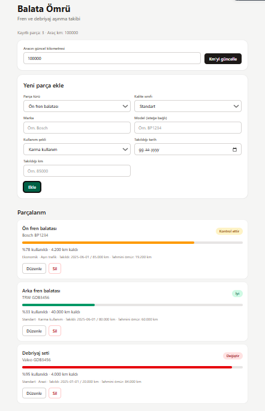
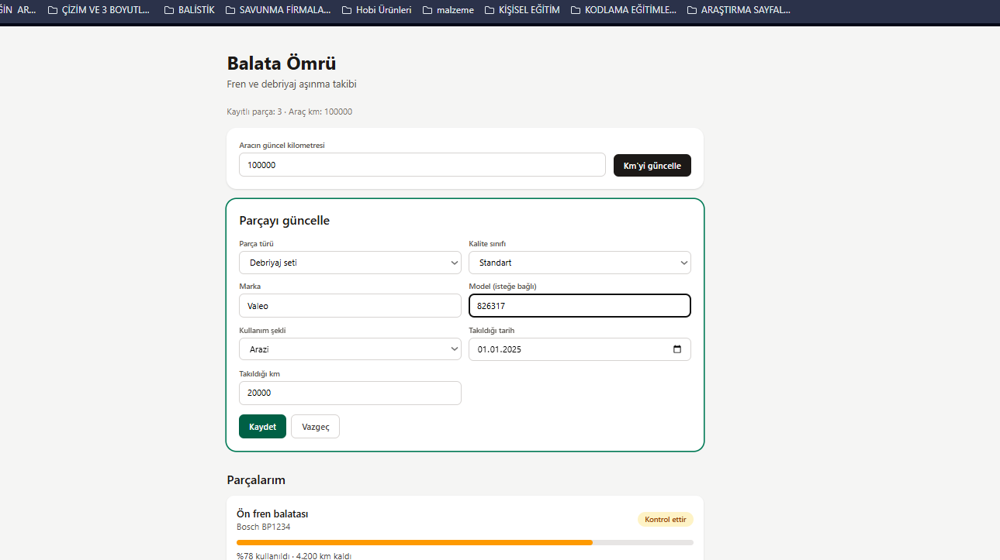
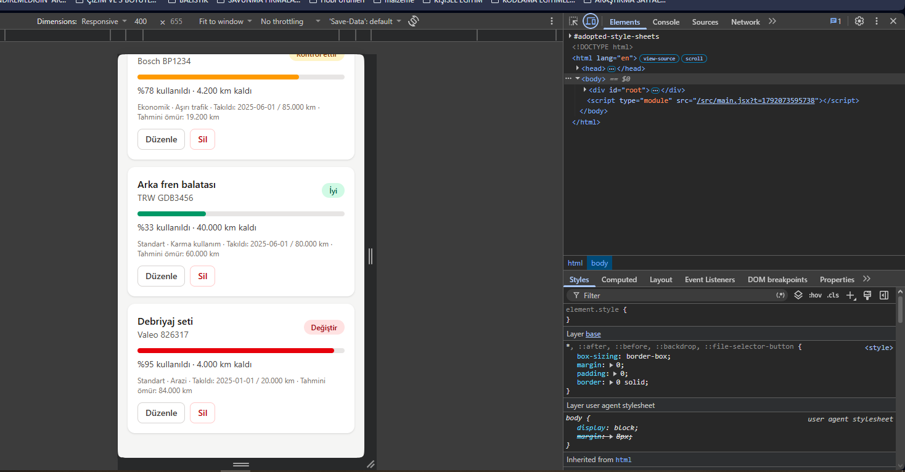
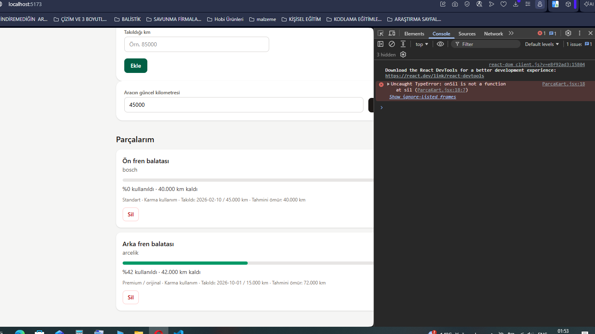

# 🛞 Balata Ömrü

Arabanın fren balatası ya da debriyajı ne zaman değişmeli? Çoğumuz bunu ya servise sorarız ya da ses gelene kadar fark etmeyiz. Fren ve debriyaj, hasar gördüğünde sonuçları ciddi olabilecek parçalar. Bu uygulamayı, bu soruya önceden cevap verebilmek için yaptım.

Parçanın ne zaman takıldığını, aracın nasıl kullanıldığını ve parçanın kalitesini giriyorsun. Uygulama da parçanın ne kadar yıprandığını tahmin edip renkli bir uyarıyla gösteriyor.

🔗 **Canlı demo:** [balata-omru.netlify.app](https://balata-omru.netlify.app)



## Ne yapabiliyorsun?

- **Parça ekle:** Ön fren, arka fren ya da debriyaj seti. Marka, model, kalite, kullanım şekli, takıldığı tarih ve kilometre bilgileriyle.
- **Listele:** Her parça bir kart olarak görünür. Ne kadar yıprandığını gösteren bir çubuk ve kalan kilometre kartın üzerinde yazar.
- **Güncelle:** Yanlış girdiğin bir bilgiyi düzeltebilirsin.
- **Sil:** Değiştirdiğin parçayı listeden kaldırabilirsin.
- **Km güncelle:** Aracın kilometresini girdiğinde tüm parçalar kendiliğinden yeniden hesaplanır.

Veriler tarayıcında saklanır. Sayfayı kapatıp açsan da kaybolmaz.

## Hesap nasıl yapılıyor?

Her parçanın ortalama bir ömrü var. Bu ömür, aracı nasıl kullandığına ve parçanın kalitesine göre uzar ya da kısalır:

```
Tahmini ömür = Ortalama ömür × Kullanım çarpanı × Kalite çarpanı
```

| Parça | Ortalama ömür |
|---|---|
| Ön fren balatası | 40.000 km |
| Arka fren balatası | 60.000 km |
| Debriyaj seti | 120.000 km |

| Kullanım şekli | Çarpan | | Kalite | Çarpan |
|---|---|---|---|---|
| Düz yol / otoyol | 1,2 | | Ekonomik | 0,8 |
| Karma kullanım | 1,0 | | Standart | 1,0 |
| Arazi | 0,7 | | Premium / orijinal | 1,2 |
| Aşırı trafik | 0,6 | | | |

Sonra parçanın ömrünün ne kadarını kullandığına bakılır:

- 🟢 **İyi:** %70'in altında
- 🟡 **Kontrol ettir:** %70–90 arası ya da parça 2 yıldan eskiyse
- 🔴 **Değiştir:** %90 ve üzeri

> ⚠️ Buradaki değerler ortalama tahminlerdir, kesin bir ölçüm yerine geçmez. Frende ses, titreme ya da pedalda farklılık hissedersen uygulamanın ne dediğine bakmadan servise git.

## Ekran görüntüleri

| Parçayı düzenlerken | Telefonda |
|---|---|
|  |  |

### Geliştirirken öğrendiğim bir şey

Sil butonu ilk denemede çalışmadı. Ekranda hiçbir hata yoktu ama tarayıcının konsolunu açınca sorunu gördüm: `onSil is not a function`. Silme fonksiyonunu karta ileten dosyalardan biri kaydedilmemişti. Kaydedince her şey düzeldi. Bu bana hatayı tahmin etmek yerine konsola bakmayı öğretti.




## Neler kullandım?


- **React** (Vite ile kuruldu)
- **Tailwind CSS**
- **LocalStorage** (verileri saklamak için)
- **Netlify** (yayına almak için)

## Klasör yapısı

```
src/
├── components/   → Form, kart, liste ve km kutusu
├── pages/        → Ana sayfa
├── interfaces/   → Ortalama ömürler ve çarpanlar
└── utils/        → Ömür hesaplama formülü
```

## Kendi bilgisayarında çalıştırmak istersen

```bash
git clone https://github.com/sugaribo-crypto/balata-omru.git
cd balata-omru
npm install
npm run dev
```

Sonra tarayıcıda `http://localhost:5173` adresini aç.

---

Bu proje, web geliştirme eğitimi kapsamında hazırlandı. 🚗